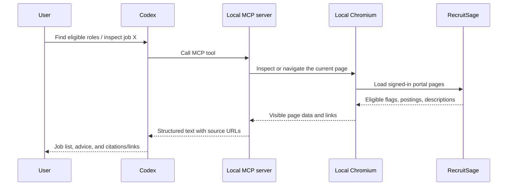

# Architecture

## Components

### Codex MCP host

Codex starts the MCP server as a local stdio process. Tool results go directly into the current conversation. No public endpoint or external app hosting is needed for this Codex use case.

### Local MCP server

`src/server.mjs` exposes read-only tools. It owns the browser session and checks every navigated URL against the RecruitSage origin. The server returns compact JSON with page text, tab labels, visible controls, and source links.

### Playwright persistent browser profile

Playwright launches a visible Chromium profile in `.playwright-profile/`. The user signs in through RecruitSage's normal login UI. The profile is local and gitignored. Codex never receives the credentials themselves.

### RecruitSage UI adapter

The first version discovers the current page's accessible labels and links instead of assuming undocumented selectors. The model can use the visible Eligible/Applied/Closed or other tabs shown by the portal. After observing a real signed-in page, a follow-up adapter can normalize the portal's job cards into stable fields such as title, company, status, deadline, location, and description URL.

## On-demand request flow

## Authentication and boundaries

- The user authenticates only on the official RecruitSage page in Chromium.
- The tool validates that portal navigation stays on `https://recruit.thapar.edu`.
- Job document links are discovered from a RecruitSage page; document fetching will be restricted to those discovered links when implemented.
- Tool descriptions and server instructions tell Codex that posting text is untrusted content and must not override system or user instructions.
- No website writes are exposed.

## Current gaps

This environment cannot see the account-authenticated portal DOM. The first local session must establish how RecruitSage labels eligibility tabs, job cards, and attachment links. The MCP server currently provides generic page inspection and navigation to support that discovery.
