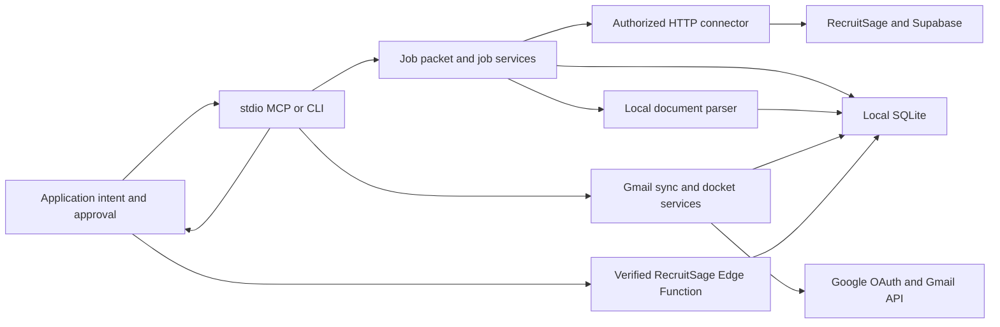

# Active architecture

The working implementation is the uncommitted API-first Node.js bridge under `src/*.mjs`. Git `main` still contains the retired Playwright server. Historical design notes remain in `docs/PROJECT_BRIEF.md`, `docs/IMPLEMENTATION_PLAN.md`, and `docs/FIRST_RUN.md`; they do not describe the runtime.

## Data flow

- `src/auth.mjs` reads owner-only `.env` and `data/auth/session.json`, rotates Supabase tokens before expiry, and retries one rejected request through `src/http.mjs`. The refresh token is never returned by a tool.
- `src/http.mjs` limits routes to the RecruitSage API host. `src/jobs.mjs` owns pagination, normalization, eligibility, application reads, attachment downloads and document hashes.
- `src/store.mjs` owns the existing SQLite database. Its additive migration tracks snapshot presence, additions, changes, removals and packet snapshots without deleting historical jobs.
- `src/parse.mjs` extracts bounded text from verified PDF, ZIP, DOCX and UTF-8 text files. ZIP entries are checked before decompression and are never extracted as files.
- `src/job-packet.mjs` combines live detail, application and attachment reads with labeled cached eligibility, rounds and document text. MCP handlers in `src/mcp.mjs` only validate and call services. `src/cli.mjs` uses the same services.
- `src/document-excerpt.mjs` resolves a document UUID or SHA-256 through SQLite, reads only the expected owner-only file under `data/documents/<jobId>/`, and returns bounded local excerpts. Keyword mode paginates matches; browse mode paginates characters. PDF page spans and extraction timestamps are stored with the document metadata. Legacy PDFs can be reparsed from the cached binary once, without HTTP, to backfill that evidence.
- `src/application.mjs` owns 30-minute application intents, fresh eligibility/duplicate checks, portal-resume selection, screening answers, exact approval and post-submit verification. `src/http.mjs` allowlists only the observed `submit-job-application` Edge Function. Mutation requests are never automatically retried; an ambiguous outcome stays pending until the application row is visible.
- The existing Plus-account tunnel runs this stdio server through the existing LaunchAgent. The SQLite file has no public listener.
- `src/gmail-auth.mjs` implements Desktop OAuth with PKCE, a local loopback callback and per-account owner-only refresh credentials. `src/gmail-http.mjs` permits read-only Gmail API routes, retries bounded rate limits and refreshes once after 401. `src/gmail-sync.mjs` owns the bounded initial scan, history cursor updates and deterministic job matching. `src/gmail-store.mjs` adds account-scoped messages and docket rows in the existing SQLite database. Gmail authorization is independent of RecruitSage and the OpenAI tunnel.
- `src/student-identity.mjs` stores verified per-account email, optional name variants and registration IDs in an owner-only local profile. `src/shortlist.mjs` fetches a selected message and its supported attachment through Gmail, verifies content and hash, then produces an evidence-backed stage event. `src/shortlist-xlsx.mjs` parses bounded XLSX workbooks without evaluating formulas. PDF, ZIP and DOCX use `src/parse.mjs`. Attachment bytes use hash-based owner-only storage; event IDs are deduplicated by message, document, job and stage.
- SQLite additions include account-scoped `gmail_attachments` and `selection_events`. Event history is retained. `placement_docket` projects the same job-level stage summary onto each message-linked docket row for that job; the underlying selection event remains one record. Docket output never treats absence from a non-exhaustive file as rejection and keeps stages separate.
- Sprint 2C adds `gmail_triage`, keyed by account and message. Gmail messages, pending triage work and the history cursor are committed in one SQLite transaction. A live sync then claims at most three pending/error items, resolves one unique cached RecruitSage job, and invokes the existing shortlist analyzer. A five-minute processing lease allows recovery after process interruption. Results and review reasons remain local; `sync_gmail` and `get_placement_docket` return bounded queue counts and source references. New history messages with a shortlist subject are inspected even outside the account's narrow placement filter, but only messages with supported attachments enter the queue. Initial baseline remains bounded by the configured Gmail query.

## Packet freshness

- `live` always requests job detail over authenticated HTTP. Attachments and application status are also requested separately; their failures appear as explicit states. Eligibility and rounds remain labeled as cached bundle data.
- `cache` never makes a network request. It reports the packet snapshot and the job/eligibility timestamps. A missing snapshot or document is explicit.
- `auto` uses a packet snapshot no older than 15 minutes when its requested document entries are cached; otherwise it makes live requests.
- Live attachment metadata does not imply a fresh binary download. A document entry reports its local cache source, SHA-256 and download timestamp when known. Legacy cached documents have an unknown download time.

## Boundaries

Application submission is the only write operation. It requires an expiring prepared intent and exact per-job approval, and success requires a live portal record. All other job, Gmail, attachment, project and Sensei tools remain local/read-only. Job content is untrusted. No browser automation, offer acceptance, email sending, calendar mutation or unrelated profile editing is exposed. Gmail bodies and shortlist files remain local; tools return matched row coordinates and evidence references, never unrelated candidate rows. RecruitSage routes are observed backend behavior, not a published contract.
